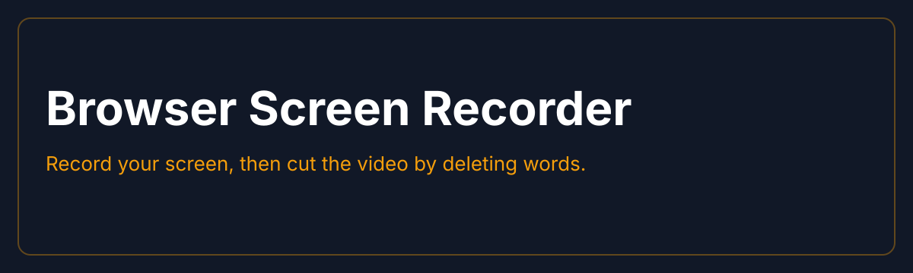

# Browser Screen Recorder + Transcript Editor



[](https://github.com/mrabr381/browser-screen-recorder/actions/workflows/ci.yml)
[](https://www.python.org/)
[](LICENSE)
[](#privacy)
[](#loom-vs-this-project)
[](extension/)

**Record your screen, then cut the video by deleting words from the
transcript.** A free, local alternative to Loom: record with a Chrome
extension, transcribe on your own machine with Whisper, edit the
transcript like a document — and the video cuts itself to match. No
server, no upload, no 5-minute cap, no 25-video limit.

> **Status, stated plainly:** the Python editor is tested on the bundled
> sample (below). The Chrome extension has **not** been load-tested in a
> real Chrome yet — its JavaScript passes `node --check` and the manifest
> parses, but the first real Load-unpacked run is still an open check.
> There is no live demo page yet (GitHub Pages is not enabled for this
> repo), so nothing here links to one.

## What it does

- **Record** — Chrome extension (Manifest V3): screen, window or tab,
  system/tab audio, optional camera picture-in-picture. Saves a WebM.
- **Transcribe** — local Whisper (`tiny` by default, ~75 MB model download
  on first run) with word-level timestamps. No API key, no account.
- **Edit** — tick words to delete in the Streamlit app (or the CLI); cuts
  land on exact word boundaries.
- **Export** — edited video (WebM), re-timed subtitles (`.srt`), edited
  transcript (`.txt` / `.json`) and a cut report (`cuts.json`).

## Before / after

Real run on the bundled sample (33.6 s, Harvard-sentences speech, transcribed in ~8 s):

| | Before | After |
|---|---|---|
| Video length | 33.6 s | **31.4 s** |
| Transcript | "These days a chicken leg is a rare dish." included | sentence deleted, video cut 10.88 s – 13.12 s |
| Words | 82 | 73 kept, 9 deleted |
| Subtitles | 10 cues | 9 cues, re-timed (cue 4 now starts 12.13 s, was 14.37 s) |

```json
// cuts.json (after deleting words 27-35)
{"original_duration": 33.608, "edited_duration": 31.368, "words_total": 82, "words_deleted": 9, "removed_ranges": [[10.88, 13.12]], "kept_ranges": [[0.0, 10.88], [13.12, 33.608]]}
```

Full sample edit in the repo: [sample_data/sample_output/index.html](sample_data/sample_output/index.html)
(static page — before/after, cut report, edited SRT, download links).

## Loom vs this project

Loom's free tier: 25 videos, 5 minutes each, 720p cap, cloud transcription
on paid plans, recordings on Loom's servers, then paid. This project:
unlimited videos, no length cap, your screen's quality, local Whisper free,
transcript editing that cuts the video (Loom has none), recordings in your
Downloads folder, free forever. Loom's limits are the only competitor
numbers quoted here; the rest is this project's own verified behaviour.

## Quickstart

```bash
git clone https://github.com/mrabr381/browser-screen-recorder.git && cd browser-screen-recorder
python3 -m venv .venv && .venv/bin/pip install -r requirements.txt
```

You also need **ffmpeg** (cutting) and **Chrome** (the extension). First
transcription downloads the Whisper tiny model (~75 MB) once and caches it.

## Install the Chrome extension

1. Open `chrome://extensions`, turn on **Developer mode**.
2. Click **Load unpacked** and pick this repo's `extension/` folder.
3. Click the extension icon → **Open recorder** → **Start recording**, pick a
   screen, window or tab. **Stop & save** — the WebM lands in Downloads.

The extension asks for no data: no analytics, no network calls, no
server. Recording happens in a full tab (a popup cannot keep recording
once it loses focus).

## Use it

**Web app (easiest):** `.venv/bin/streamlit run app.py`, open http://localhost:8501
— upload a recording, transcribe, tick words to delete, download the edited
video, SRT and transcript. Or click **Load the bundled sample transcript**
to try the editor with no recording. **1-click deploy:** share.streamlit.io
→ repo `mrabr381/browser-screen-recorder`, branch `main`, file `app.py` →
Deploy. (Cloud step, not tested by the author. Cutting needs ffmpeg on the
host — add a `packages.txt` with `ffmpeg` — and the extension still has to
be loaded in your own Chrome.)

**CLI:**

```bash
.venv/bin/python -m recorder transcribe recording.webm --out report/
.venv/bin/python -m recorder cut recording.webm report/transcript.json \
    --delete-words 27-35 --out edited/
.venv/bin/python -m recorder cut recording.webm report/transcript.json \
    --delete-text "um, uh" --out edited/   # delete by word text
```

Exit codes: `0` ok, `1` runtime error (plain message, no traceback), `2` bad
usage. The sample video is binary, so its transcript — not the video — is in
the repo; rebuild it with `bash sample_data/make_sample.sh`.

## Privacy

Recordings stay in **your** Downloads folder; transcription runs on **your
CPU** (the ~75 MB model download, once, is the only network use); cutting
runs on **your machine** with local ffmpeg. No accounts, no keys, no telemetry.

## Honest limitations

- **Whisper tiny mishears sometimes.** On the sample it heard "The birch canoe
  slid on the smooth planks" as "The birch can use lid on the smooth planks" —
  tiny is fast, not perfect. Use `--model base` or `small` for better accuracy.
- **First transcription downloads the model** (~75 MB tiny, more for
  base/small) from Hugging Face. After that it works offline.
- **The extension was not load-tested in a real Chrome here** — no Chrome
  binary exists in this sandbox; first real Load-unpacked run is the
  remaining check.
- **Cutting re-encodes** the kept ranges (VP9/Opus), so a long video takes
  a while — accuracy over speed, cuts land on exact word boundaries.

## Development & testing

```bash
python -m pytest   # transcript cut maths — no model or ffmpeg needed
```

## Contributing

Issues and pull requests are welcome. Keep the quality promise: no invented
numbers, no hardcoded keys, no network calls at runtime, and every new
feature covered by a test on the sample recording.
